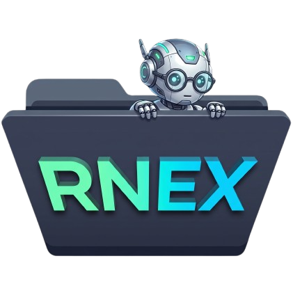

<p align="center">
  <a href="https://unoxen.github.io/repo-nexus/">
    
  </a>
</p>

# Repo Nexus (rnex)

[](https://github.com/unoxen/repo-nexus/actions/workflows/ci.yml)
[](https://www.npmjs.com/package/repo-nexus)
[](LICENSE)
[](#)
[](#)
[](https://unoxen.github.io/repo-nexus/)

📖 **Documentation:** [https://unoxen.github.io/repo-nexus/](https://unoxen.github.io/repo-nexus/)

A lightweight, zero-dependency **Virtual Meta Repository** (**meta repo**) and **Nexus Repository** (**nexus repo**) manager for multi-repo workspaces and shared AI context. Repo Nexus organizes independent Git repositories into a unified **nexus repository** and **meta repository** workspace—sharing lean routing instructions (`AGENTS.md`) **without Git submodules, monorepo migrations, or symlink fragility**.

- **No Git Submodules or Nested Git Collisions**: Member repositories are physically cloned into `./<repos_dir>/` (default: `./repos/`, configurable via `repos_dir`) and strictly ignored by workspace Git. Each repository maintains its own standalone history, remotes, branches, and commits with zero submodule friction.
- **Unified Workspace for AI Coding Assistants**: Open one root folder to give Cursor, Claude Code, GitHub Copilot, Codex, or Antigravity complete cross-service visibility.
- **Two-Level Configuration as Source of Truth**: Shared team manifest in `rnex.yaml` with machine-specific overrides in `.local.rnex.yaml` (highest priority).
- **One Command Team Onboarding**: Teammates clone the **meta repository** (**meta repo** / **nexus repo**) and run `rnex clone` to clone and configure all member repositories in seconds.
- **Cross-Repo Batch Operations**: Run arbitrary commands across all active repositories with `rnex exec <command>`.
- **Scoped Plugins & Context Packs**: Modular plugin packages scoped under `.rnex/plugins/<plugin-name>/` with support for domain directories (e.g. `wiki/` and `./docs` for `karpathy-llm`).
- **Zero Dependencies**: Pure POSIX shell CLI (`rnex`). Works out of the box across macOS, Linux, and Windows (WSL/Git Bash).

> 📖 **Documentation & Guides**
>
> Explore the comprehensive documentation, architecture guides, and interactive references on the **[Documentation Site](https://unoxen.github.io/repo-nexus/)**:
>
> - 🚀 **[Getting Started](https://unoxen.github.io/repo-nexus/introduction/quick-start)** — Step-by-step onboarding walkthrough and workspace setup
> - 📐 **[Architecture](https://unoxen.github.io/repo-nexus/documentation/architecture)** & **[Why Repo Nexus?](https://unoxen.github.io/repo-nexus/introduction/why-rnex)** — Virtual Meta-Repo model, directory layout, and design rationale
> - 💻 **[CLI Reference](https://unoxen.github.io/repo-nexus/reference/cli)** — Complete command syntax, global flags, batch execution (`rnex exec`), and Git hooks
> - 🧩 **[Plugins Guide](https://unoxen.github.io/repo-nexus/documentation/plugin-ecosystem)** — AI provider integrations (Claude, Codex, Copilot, Cursor, Gemini, Windsurf) and Karpathy LLM Wiki
> - ⚙️ **[Configuration Schema](https://unoxen.github.io/repo-nexus/documentation/configuration)** — Two-level `rnex.yaml` and `.local.rnex.yaml` specification
> - ❓ **[Frequently Asked Questions (FAQ)](https://unoxen.github.io/repo-nexus/faq/general)** — Common questions, Git submodule differences, and context strategies

---

## Table of Contents

- [Multi-Repo Workspace Manager Overview](#multi-repo-workspace-manager-what-repo-nexus-is-and-what-it-isnt)
- [AGENTS.md Context Sync & Key Principles](#agentsmd-context-sync--key-principles)
- [POSIX CLI Installation](#posix-cli-installation)
- [Quick Start: POSIX CLI Workflows](#quick-start-posix-cli-workflows)
- [Project Structure](#project-structure)
- [Running Tests](#running-tests)
- [Contributing](#contributing)
- [License](#license)

---

## Multi-Repo Workspace Manager: What Repo Nexus Is (and What It Isn't)

| What It Is | What It Isn't |
| :--- | :--- |
| **A lightweight nexus repository & meta repository CLI** (modular pure POSIX `/bin/sh` CLI). | **NOT a replacement for your workspace or tools.** It doesn't replace VS Code, Cursor, JetBrains, or your terminal. |
| **A Virtual Meta Repo & Nexus Repo orchestrator** managing autonomous member clones in `./<repos_dir>/` (default: `./repos/`). | **NOT a build tool or monorepo orchestrator.** It doesn't replace tools like Nx, Turborepo, Cargo, or Gradle. |
| **Zero Git friction.** Repositories remain normal, autonomous Git repos. | **NOT Git submodules or subtrees.** No `.gitmodules` files, no detached HEADs, no commit coordination lock-in. |
| **Strictly encapsulated.** Internal rnex assets live exclusively in `.rnex/`. | **NOT invasive.** Member repositories remain clean; workspace-related context is isolated to `<repos_dir>/<name>/.rnex/`. |

---

## AGENTS.md Context Sync & Key Principles

1. **Configuration as Single Source of Truth**:
   Every agent workflow and command starts by reading the configuration files. `.local.rnex.yaml` takes **highest priority** over `rnex.yaml`. Top-level `repos_dir` configures where member repositories reside (default: `repos`).

2. **No Git Submodules (Complete Repository Autonomy)**:
   Member repositories are cloned directly into `./<repos_dir>/<name>` (default: `./repos/<name>`). The root workspace `.gitignore` dynamically ignores the configured `repos_dir/`, ensuring the workspace repository never tracks or interferes with member Git histories, remotes, branches, or commits.

3. **Enabled by Default with Two-Level Merging**:
   Member repositories are enabled by default. Developers can selectively disable specific repositories locally in `.local.rnex.yaml` (`enabled: false`) without mutating the shared `rnex.yaml`. Disabled repositories are skipped by `clone` and `exec`.

4. **Routing-Only Top-Level AI Instructions (AGENTS.md Context Sync)**:
   `AGENTS.md` (and related top-level instruction files) contains no inlined plugin rules or tool boilerplate. It acts solely as a lean navigation router directing AI agents to configuration files, scoped plugins, and member `.rnex/` contexts.

5. **Strict File Encapsulation**:
   All `rnex`-managed internal files live exclusively in `.rnex/`. Member repositories isolate Repo Nexus assets in `<repos_dir>/<name>/.rnex/`.

---

## POSIX CLI Installation

Install `rnex` via npm, standalone one-liner (`curl` / `wget`), or from source:

### Option 1: Via npm (Global)

```bash
npm install -g repo-nexus
```
*(Installs both `repo-nexus` and `rnex` commands globally, or run without installing via `npx repo-nexus init`)*

### Option 2: Standalone One-Liner (curl / wget — Zero Dependencies, No Node.js)

```bash
curl -fsSL https://raw.githubusercontent.com/unoxen/repo-nexus/main/scripts/install.sh | sh
# or
wget -qO- https://raw.githubusercontent.com/unoxen/repo-nexus/main/scripts/install.sh | sh
```
*(Downloads and links `rnex` and `repo-nexus` into `~/.local/bin` without requiring Node.js or npm)*

### Option 3: Native Installer (Clone & Install)

```bash
git clone https://github.com/unoxen/repo-nexus.git
cd repo-nexus
./rnex install
```
*(Installs `rnex` and `repo-nexus` into `~/.local/bin`, or pass a custom directory like `./rnex install /usr/local/bin`)*

---

## Quick Start: POSIX CLI Workflows

```bash
# 1. Initialize a new workspace
mkdir my-workspace && cd my-workspace
rnex init

# 2. Register and clone repositories
rnex repo add git@github.com:myorg/backend-api.git --name backend
rnex repo add https://github.com/myorg/web-app.git --name frontend

# 3. Check workspace health
rnex status

# 4. Run a batch command across all member repos
rnex exec git status -s
```

When a teammate clones your workspace, they simply run:
```bash
rnex clone
```
All declared member repositories are cloned and wired up automatically!

---

## Project Structure

```text
repo-nexus/
├── package.json                    # npm package manifest (single version source of truth)
├── rnex                            # CLI entrypoint (pure POSIX /bin/sh)
├── lib/                            # Modular POSIX shell libraries
│   ├── core.sh                     # Terminal colors, logging, path & version helpers
│   ├── yaml.sh                     # Two-level YAML parser & config mutators
│   ├── workspace.sh                # Workspace root discovery & auto-sync engine
│   ├── repos.sh                    # Member repo path resolution & on-demand .rnex/
│   ├── plugins.sh                  # Plugin discovery, template & command engine
│   ├── sdk.sh                      # Plugin Hook SDK & User Skill generator
│   ├── ai.sh                       # AI routing instructions, .gitignore & .code-workspace
│   ├── hooks.sh                    # Declarative Git hooks & lifecycle event dispatcher
│   ├── commands.sh                 # CLI subcommand module loader
│   └── commands/                   # Subcommand implementations (init, sync, repo, etc.)
├── AGENTS.md                       # Routing-only universal AI instructions
├── CHANGELOG.md                    # Release history and migration notes
├── CONTRIBUTION.md                 # POSIX standards, testing setup, and plugin contract
├── templates/
│   ├── ai-instructions.sample.md   # Base template for .rnex/ai-instructions.md
│   └── rnex.example.yaml           # Full config reference with examples
├── docs/
│   ├── introduction/               # Welcome, Why rnex?, Quick Start, and Pure Examples
│   ├── documentation/              # Architecture, Configuration, Workflows, Lifecycle, Plugins
│   ├── reference/                  # CLI Reference, RNEX Hooks, Git Hooks, and Environment
│   ├── plugins/                    # Scoped plugin guides and specifications
│   └── faq/                        # Frequently Asked Questions & Troubleshooting
├── .github/
│   └── workflows/ci.yml            # GitHub Actions CI workflow
├── scripts/
│   ├── install.sh                  # Zero-dependency standalone installer
│   └── githooks/                   # Repository maintainer release hooks
├── tests/
│   ├── test_cli.sh                 # Main test runner
│   ├── test_helper.sh              # Shared test harness and utilities
│   └── suites/                     # Modular test suites (01–07)
├── toolkit/                        # Built-in plugins and core agentic skills
│   ├── plugins/                    # Scoped workspace & AI provider plugins
│   └── skills/                     # Core workspace agentic skills
└── README.md
```

---

## Running Tests

```bash
./tests/test_cli.sh
```

---

## Contributing

Contributions are welcome! Please read [CONTRIBUTION.md](CONTRIBUTION.md) for coding standards (pure POSIX shell, ShellCheck compliance), local development & maintainer Git hooks setup, automated test workflows, and plugin authoring guidelines.

---

## License

[Apache 2.0](LICENSE)
