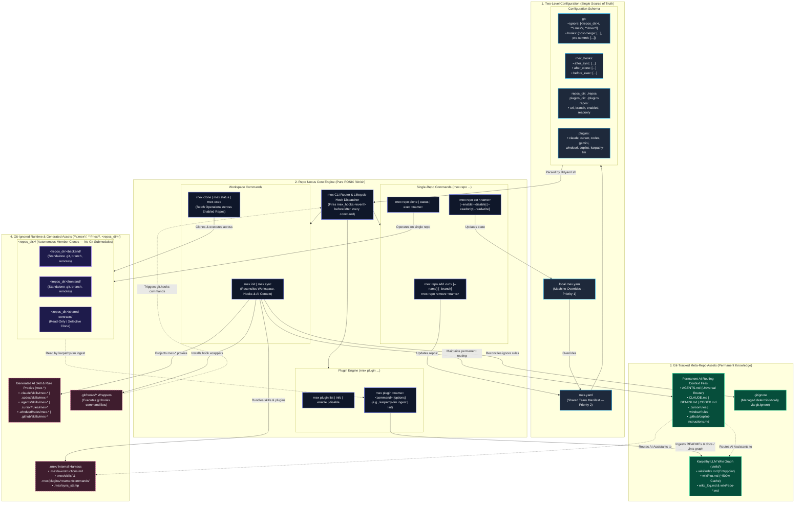

# Architecture

Repo Nexus coordinates multiple repositories through a declarative directory hierarchy that balances workspace-wide orchestration with complete member repository autonomy in a unified meta repository (meta repo) and nexus repository (nexus repo).

## Architecture Diagram

The following diagram illustrates how configuration flows through the core engine to manage tracked meta-repo assets, git-ignored runtime files, and autonomous member clones:



---

## Filesystem Layout

A fully initialized Repo Nexus workspace is structured as follows:

```text
my-workspace/
├── .git/                            # Meta-repo Git tracking (workspace config & docs only)
├── .gitignore                       # Managed deterministically via git.ignore
├── .ignore                          # Un-ignores <repos_dir>/* for ripgrep, Claude Code, and search tools
├── rnex.yaml                        # Team-wide workspace declaration (repos_dir, plugins_dir, repos, plugins)
├── .local.rnex.yaml                 # (Optional) Developer workstation overrides (gitignored)
│
├── .rnex/                           # Workspace orchestration directory (gitignored)
│   ├── ai-instructions.md           # Compiled AI routing & plugin context
│   ├── sync_stamp                   # Checksum-based drift detection stamp
│   ├── plugins/                     # Enabled plugin instructions, skills, and agents
│   └── skills/                      # Core workspace agentic skills (clone-sync, batch-exec, etc.)
│
├── <repos_dir>/                     # Member repository clones (default: repos/, configurable via repos_dir)
│   ├── backend/                     # Standard Git repository (remote: api.git)
│   │   ├── .git/
│   │   └── src/
│   └── frontend/                    # Standard Git repository (remote: web.git)
│       ├── .git/
│       └── src/
│
├── <plugins_dir>/                   # (Optional) External workspace plugins (configurable via plugins_dir)
│   └── custom-plugin/               # External plugin bundle (plugin.yaml, hooks/, commands/, skills/)
│
├── AGENTS.md                        # Permanent universal AI agent router
├── CLAUDE.md                        # Permanent Claude Code router
├── CODEX.md                         # Permanent OpenAI Codex router
└── workspace.code-workspace         # (Optional) VS Code / Cursor multi-root configuration
```

## Core Architectural Pillars

### 1. Member Repository Isolation & Autonomous Git Roots (`./<repos_dir>/`)
Member repositories reside in `./<repos_dir>/<name>/` (default: `./repos/<name>/`), dynamically configurable via top-level `repos_dir` in `rnex.yaml` or `.local.rnex.yaml` (or via `rnex init --repos-dir <dir>`). Each repository retains its own independent `.git` directory, remote tracking branches, tags, and commit history.

::: warning Never Commit Member Repositories to Meta-Repo
Repo Nexus automatically configures `.gitignore` in the meta-repo root with:
```text
<repos_dir>/
**/.rnex*/
**/rnex*/
```
Member repository files are never tracked or committed to the parent meta-repo.
:::

To ensure code search tools (ripgrep, Claude Code, VS Code search) and AI indexers (Cursor codebase indexing, Gemini CLI) can discover and index member code across repos, Repo Nexus automatically maintains un-ignore files (`.ignore`, `.cursorignore`, `.geminiignore`) with `!<repos_dir>/*`. This allows AI assistants and search engines to index code while meta-repo Git remains completely clean.

### 2. The `.rnex/` Orchestration Directory
The `.rnex/` directory encapsulates active plugins, automation hooks, and agentic skills:
* **`.rnex/skills/`**: Core workspace-wide agentic skills owned by `rnex` (`clone-sync.md`, `batch-exec.md`, `workspace-status.md`).
* **`.rnex/plugins/`**: Isolated directory per enabled plugin (`.rnex/plugins/<plugin-name>/`), encapsulating plugin-owned skills, rules, and commands without naming collisions.

### 3. Non-Destructive Delimited Merging & Permanent Routing
Repo Nexus injects workspace routing rules into developer instruction files (`AGENTS.md`, `CLAUDE.md`, `GEMINI.md`, `CODEX.md`, `.cursorrules`, `.windsurfrules`, `.github/copilot-instructions.md`) by isolating managed blocks inside explicit HTML comments:

```markdown
<!-- REPO-NEXUS:START -->
CRITICAL: You MUST read and strictly follow all instructions in `.rnex/ai-instructions.md` before executing any task or answering any query in this workspace.
<!-- REPO-NEXUS:END -->
```

::: tip Preserving Custom Instructions
Any custom guidelines, rules, or documentation authored outside the `<!-- REPO-NEXUS:START -->` and `<!-- REPO-NEXUS:END -->` markers are strictly preserved during `rnex sync` or plugin reconfiguration.
:::

### 4. Multi-Root IDE Workspaces
When enabled via `--code-workspace`, Repo Nexus generates a VS Code / Cursor `.code-workspace` file that automatically registers the workspace root and every active member repository in `./<repos_dir>/`. Opening the workspace file opens all repositories in a single unified editor window.
